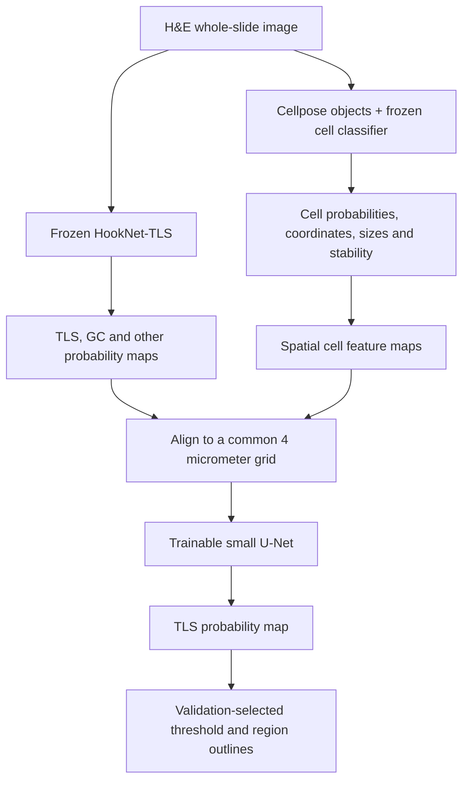

# Cell–HookNet TLS region model

Design proposal • 20 October 2026 • Not implemented or trained

Build a supervised segmentation model that combines frozen HookNet-TLS probability maps with spatial features from our frozen cell classifier. Predict a continuous TLS probability map, then extract region outlines. The hypothesis is that cell composition and organization improve tissue-level predictions; improvement must be demonstrated on independently annotated patients.

## Architecture

The initial model learns from predictions and cell features rather than changing either pretrained backbone. This also permits HookNet to remain in its TensorFlow environment and the cell model/fusion network to run in PyTorch, communicating through versioned files. Later feature-level fusion or backbone fine-tuning is a separate experiment, justified only after this baseline.

## Inputs and coordinate contract

Use a common 4 µm grid in slide physical coordinates. Store slide ID, patient ID, source dimensions, micrometers per pixel for each axis, affine transform, pixel-center convention, class order, checkpoint hashes, and valid coverage for every input. Do not reuse the current single-slide hardcoded 0.252 µm calibration on other slides.

The current HookNet runner uses 0.5 µm detail and 2 µm context inputs. It writes uint8 TLS/GC probability maps and a class mask. The ESCA runner retains 4 µm maps by point sampling. For new fusion training, export all three softmax channels as floating-point, area-averaged 4 µm maps before quantization, together with inference coverage. Never average class IDs. Existing uint8 maps divided by 255 may support a flagged pilot; reconstruction of the other class is approximate because of quantization and tissue masking.

Verify coordinate alignment using synthetic landmarks and real overlays. Respect the current 1030-to-1024 prediction crop and writer origin; do not assume a centered crop. If spatial offsets are found, version the correction and regenerate every affected training and evaluation feature cache.

Use these 23 input channels, in a fixed documented order:

| Channels | Definition |
|---|---|
| 3 HookNet channels | Probabilities of other, TLS and germinal center (GC), retained separately |
| 12 cell density channels | Probability-weighted density of B, T, macrophage and other objects at Gaussian scales σ = 25, 75 and 150 µm |
| 1 total density channel | All segmented objects per mm² at σ = 25 µm |
| 2 object size channels | Locally weighted mean and standard deviation of object area at σ = 25 µm |
| 2 cell stability channels | Locally weighted mean normalized class entropy and orientation disagreement at σ = 25 µm |
| 3 coverage channels | Tissue fraction, valid cell-processing coverage and valid HookNet coverage |

For each type c and scale σ, splat each object's probability p(i,c) onto the grid and apply a normalized Gaussian kernel:

`D(c,σ,x) = 10^6 × Gaussianσ(probability mass)(x) / [16 × max(Gaussianσ(valid tissue fraction)(x), 0.5)]`.

The factor 16 is the grid-bin area in µm². Supply coverage to distinguish tissue edges, processing gaps, and truly sparse tissue. Use fractional splatting to reduce grid-position artifacts. Calculate maps before tiling, or use a feature-building halo of at least 3 × the largest σ. Empty-neighborhood size/stability values are zero with zero density; missing processing is identified by coverage, never silently interpreted as absence of cells.

Use all four averaged D4 probabilities rather than hard B/T labels. Entropy and orientation agreement describe model behavior; they are not validated probabilities that a cell label is correct. Segmented object sizes remain nuclear proxies.

Transform density with log1p and standardize continuous features using training patients only. Keep probabilities and coverage on their natural scales. Record and freeze normalization statistics.

## Trainable model and target

Start with a small four-resolution U-Net: widths 32, 64, 128 and 256; two padded 3×3 convolutions per block with GroupNorm and SiLU; three downsampling steps; bilinear upsampling with skip connections. Concatenate all 23 maps at input. Use a 1×1 output convolution and sigmoid for TLS probability.

Initial input tiles are 512×512 grid pixels (2.048 mm across). Score/train the central 256×256 pixels, retaining 128 pixels of context on each side. Slide-edge padding has coverage zero. Tile centers cover all valid tissue, including areas outside HookNet proposals, so the combined model can discover candidates HookNet missed. These dimensions are starting hyperparameters, not established optimum values.

The supervised target is the full annotated TLS envelope, including a germinal center when present. Preserve the distinction between HookNet's GC and TLS classes in the inputs. For a simple HookNet whole-envelope baseline, use TLS+GC probability only after verifying their mutually exclusive class semantics. Do not require GC presence or a fixed minimum B/T count for a TLS prediction.

An optional later GC head would use `P(GC) = P(TLS) × P(GC | TLS)`, trained only where GC annotations are available. Version 1 has only the TLS output; it does not infer maturity classes.

## Labels and training

Require expert-reviewed TLS outlines, explicitly reviewed negative tissue, and an annotation coverage mask. Agree on inclusion of early aggregates, boundary conventions, normal lymphoid tissue, and ambiguous cases before annotation. Ambiguous and unreviewed areas receive an ignore label. Slide-level RNA signatures, model consensus and existing A/R candidates are supporting information or annotation proposals, not TLS ground truth.

Use patient-disjoint training, validation and locked test sets; all slides and sections from one patient stay together. Record institution, scanner and tissue type; use a separate site or cohort for external evaluation when possible. Audit overlap with the training sources of both pretrained models. The five public LUSC cases in the current reference workflow have possible HookNet development overlap and cannot establish independent performance.

Sample annotated positives, ordinary negatives, and hard negatives such as diffuse inflammation, lymphoid tissue outside the target definition, dense tumor, and artifacts. Include both HookNet-positive/cell-poor and HookNet-negative/cell-rich examples, with expert labels. Keep the validation and test sampling representative; oversampling training positives must not determine reported prevalence or precision.

Train only the fusion network initially:

- Loss: equal-weight masked binary cross-entropy and foreground soft Dice on reviewed pixels. Omit Dice for tiles with no labeled positive pixels; BCE still trains those negative tiles. Skip tiles with no supervised pixels.
- Initial optimizer: AdamW, learning rate 0.0001, weight decay 0.0001. Select stopping point on validation data; batch size follows available memory.
- Apply spatial rotations/flips jointly to every feature and label map.
- Test modest cell-feature dropout or probability perturbation to assess tolerance to cell errors. Keep coverage flags truthful. Any missing-modality behavior must be trained and evaluated explicitly.
- Stain augmentation of cached probability maps is not meaningful. If used, augment H&E and regenerate outputs from both frozen models.

Start with a small annotation pilot to verify labels and alignment, then expand by patient-level learning curves. Thousands of tiles from one slide do not substitute for independent patients. No minimum sufficient cohort size or performance is claimed in this design.

## Inference and outputs

1. Generate both frozen-model outputs with complete provenance.
2. Align and construct feature maps; reject mismatched slide IDs or coordinates.
3. Predict every valid tissue tile and stitch central outputs into a 4 µm map.
4. Fit probability calibration, if needed, on representative held-out calibration patients within the development cohort. Choose a threshold and optional minimum region area on validation data for a declared sensitivity/false-positive tradeoff.
5. Convert thresholded components into polygons in physical coordinates and level-0 slide coordinates. Preserve holes; any cleanup or separation of touching regions must be validated and frozen before testing.
6. Report area, mean/max model score, expected B/T counts, HookNet support, cell stability, and coverage for each region. A mean pixel score is a summary, not a calibrated probability that the whole region is TLS.

Retain the continuous map and unfiltered components for review. Do not inherit the earlier 50-object/5,000 µm² morphology thresholds as untested final diagnostic rules. Mark incomplete processing explicitly and avoid issuing an ordinary fused prediction there; a HookNet-only fallback would be a separately labeled and evaluated mode.

## Experiments required to show benefit

Compare on exactly the same locked patients and annotation domain:

1. Published HookNet polygons, plus a validation-tuned HookNet probability baseline.
2. Cell-feature-only segmentation with the same training labels.
3. Simple logistic fusion on the same cached inputs.
4. The proposed spatial U-Net fusion.

Ablate B/T maps, object-size features, stability features, and multiscale densities. A pooled B+T variant tests whether subtype information helps despite uncertain labels. Compare several training seeds and obtain patient-bootstrap confidence intervals for paired improvements.

Report lesion sensitivity at fixed false positives per reviewed tissue area, lesion precision/F1 with one-to-one polygon matching, Dice/IoU in reviewed domains, and boundary error. Predeclare primary lesion IoU matching threshold (initial proposal: 0.3; secondary: 0.1 and 0.5). Stratify by region size, site and annotation category. True whole-slide false-positive rates require whole-slide review; incomplete annotations support metrics only within their explicit review domain.

Accept fusion only if it improves the predefined primary metric over tuned HookNet on held-out patients without an unacceptable boundary or subgroup degradation. Model agreement alone does not establish correctness.

## Repository integration plan

Existing components to reuse:

- `script/src/model_eval.py`: ResNet50 cell classifier with an additional mask encoder.
- `script/src/prediction_tta.py`: eight-view RGB/mask probability averaging.
- `deployment/tls_methods_v2_core.py`: cell probability/stability export and full-object morphology extraction.
- `deployment/run_hooknet_tls.py`: detail/context inference and physical map writing.
- `deployment/esca_tls/esca_hooknet.py`: cohort processing and retained 4 µm map export.

Proposed implementation units: input manifest/coordinate validation; floating-point HookNet export; cell-map builder; fusion dataset/network/trainer; slide predictor and polygon writer; patient-level evaluation. Keep these additions separate from the preserved published-model results.

Before model training, test coordinate transforms, probability mass conservation, tissue-edge correction, missing-coverage behavior, channel order, patient splits, ignored-label losses, GC-inclusive targets, and seamless tile stitching. Then overfit one annotated tile as a wiring check; this is not a performance result.

The design is ready to implement. A useful trained model still requires an audited annotation cohort and the independent comparisons above.

## Source

Published HookNet-TLS implementation and input-spacing documentation: https://github.com/DIAGNijmegen/pathology-hooknet-tls (accessed 20 October 2026). The fusion architecture and hyperparameters above are proposed here, not claims from that project.
